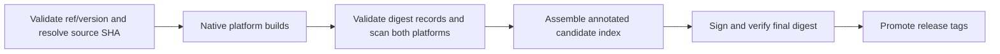

# Budget Buddy shared CI

Caller repositories own their triggers, application commands, contracts, and release configuration. This repository owns common runtime setup, validation jobs, release execution, container policy, and image publication.

## Components

| Component | Consumers | Responsibility |
| --- | --- | --- |
| `setup-node` action | API tooling, contracts, web | Node/pnpm versions, frozen install, cache, GitHub Packages authentication |
| `setup-java`, `setup-gradle` actions | API, contracts | JDK 25 and Gradle setup/cache policy |
| `commitlint.yml` | API, contracts, web | Identical PR-title and commit checks, push/manual/bot event behavior |
| `gradle-ci.yml` | API | Build/unit/integration tests, Sonar analysis, JAR artifact |
| `web-ci.yml` | Web | Lint, production build/type checks, tests |
| `contracts-validation.yml` | Contracts | Spec lint/validation, generated TypeScript typecheck and Java compilation |
| `release.yml` | API, contracts, web | Repository-scoped App authentication and serialized semantic-release |
| `gradle-dependency-submission.yml` | API | Dependency graph submission with package-read access |
| Container actions and `publish-image.yml` | API, web | Source-bound digest handoff, scans, signed manifest, tag promotion |

Reusable workflows are called as jobs with a full commit SHA. Composite actions are used where a repository keeps its own steps, such as contracts publishing. Internally, `$/` resolves actions from this library at the running workflow's commit, independent of the caller checkout. This requires GitHub.com support for [same-repository action references](https://docs.github.com/en/actions/reference/workflows-and-actions/workflow-syntax).

## Runtime policy

[Runtime versions](runtime-versions.json) are the source of truth for Node, pnpm, Trivy, and Cosign. There are no caller version overrides. Java 25 matches the API and contract-generation toolchain. Action dependencies use immutable commit pins.

The Node action installs dependencies with a frozen lockfile and configures the organization package registry. Build/release jobs allow lifecycle scripts; tooling-only commitlint jobs pass `ignore-scripts: 'true'`.

The scheduled updater checks stable upstream releases and opens a PR using the repository-scoped release App. It requires `RELEASE_BOT_ID` and `RELEASE_BOT_PRIVATE_KEY`. Its normal `GITHUB_TOKEN` remains read-only, and workflow review approval stays disabled. The App token has only contents/PR write access for this repository. App-created PRs start validation normally.

## Caller example

Replace `COMMIT_SHA` with the published library commit, and maintain the same pin across coordinated consumers:

```yaml
name: Commitlint
on:
  pull_request:
    types: [opened, synchronize, reopened, edited]
permissions:
  contents: read
  packages: read
jobs:
  commitlint:
    uses: budget-buddy-org/ci-workflows/.github/workflows/commitlint.yml@COMMIT_SHA
```

Commitlint rules and dependency lockfiles live in the consumer. All three consumers currently have equivalent rules and validate PR titles and commits. Dependabot messages are exempt. Manual runs perform setup without linting a missing commit range; new-branch pushes check history up to the pushed head. PR text is passed as data to the CLI.

Release callers pass the two App secrets explicitly and depend on successful validation. Normal publication runs only for a main push. An explicitly requested manual dry run checks the candidate ref and overrides the branch allowlist only for `--dry-run`. Repository release plugins and optional `release:verify` scripts define domain-specific preparation.

## Image publication

Both builders resolve the requested ref to one immutable commit before building native amd64 and arm64 images. API uses buildpacks; web uses its Dockerfile and receives Node/pnpm build arguments from the shared policy. Web retains SBOM, provenance, BuildKit secrets, and separate platform caches.



Platform records bind the repository, version, source SHA, architecture, and registry digest. Missing, duplicated, or mixed records fail publication. Records are retained for three days and replaced on build reruns.

The [reviewed vulnerability policy](container-policy.json) preserves existing gates: API reports fixed HIGH/CRITICAL findings without blocking on them; web amd64 blocks fixed CRITICAL findings, while arm64 reports findings. Scan infrastructure failures fail the job. Available SARIF is uploaded before applying the vulnerability gate, including when a scan fails.

Manual image runs default to candidate mode and only create `ci-<run>-<attempt>` tags. Candidate validation pulls both architectures and verifies tag-copy digest preservation. Production mode requires the matching source release tag. The signed index is promoted to its exact version, with architecture aliases retained. Only the current GitHub latest release updates `latest` and the minor-series alias. An existing version tag with different content is rejected.

Retry a failed publication job with its original digest artifacts. This preserves image content and supports idempotent tag promotion. Rebuilding an already published version with different content requires a new release version.

## Signing identity

Fulcio uses the reusable publisher's `job_workflow_ref` as the [certificate identity](https://docs.sigstore.dev/certificate_authority/oidc-in-fulcio/). Images now use this signer URI:

```
https://github.com/budget-buddy-org/ci-workflows/.github/workflows/publish-image.yml@SHARED_COMMIT_SHA
```

Verification checks the exact signer identity, `https://token.actions.githubusercontent.com` issuer, and the caller repository. Deployment policies should bind the caller and intended release context as well as the shared signer. The deployment repository currently has no signing-identity allowlist to migrate.

## Compatibility and updates

Consumers pin full SHAs and have weekly `github-actions` Dependabot updates enabled. GitHub documents that [untagged commit pins are updated to the latest commit](https://docs.github.com/en/actions/reference/security/secure-use), including reusable workflows. Runtime adoption also updates the consumer's `packageManager` declaration and lock metadata; its frozen-install and build checks must pass together.

Treat changes to required inputs/secrets, outputs, check names, artifact formats, or release/security policy as breaking interface changes. Publish the library commit first, migrate callers in explicit PRs, run their real jobs and previews, then merge consumers. Compatible fixes still require library regression checks and relevant consumer validation. Credentials remain explicit and scoped to the caller.

Nested checks include `ci / ci`, `validate / validate`, and `commitlint / commitlint`. Review branch rules when migrating check names. Caller and called workflows use distinct concurrency groups; release and image publication serialize without canceling an in-flight release.

## Validation

```sh
pnpm --dir tests/fixtures/node install --frozen-lockfile --ignore-scripts
node --test tests/*.test.mjs
```

Normal PR validation runs actionlint and real CLI/event/security tests with read-only permissions. Actionlint 1.7.12 needs the narrowly scoped `$/` syntax suppression documented in `validate.yml`; GitHub execution of those references is tested live.

Run the manually gated container fixture against a candidate library branch:

```sh
gh workflow run validate.yml --ref BRANCH --field containers=true
```

It builds and pulls both architectures, reports scans, verifies the reusable signer and digest-preserving tag copy, and requires real vulnerability findings to reject an intentionally old image. Deliberate vulnerable-fixture SARIF is not published to the Security tab. Privileged fixture jobs do not run on PR events.

See the [specialized-workflow audit](docs/workflow-audit.md) and [verification record](docs/verification.md).
